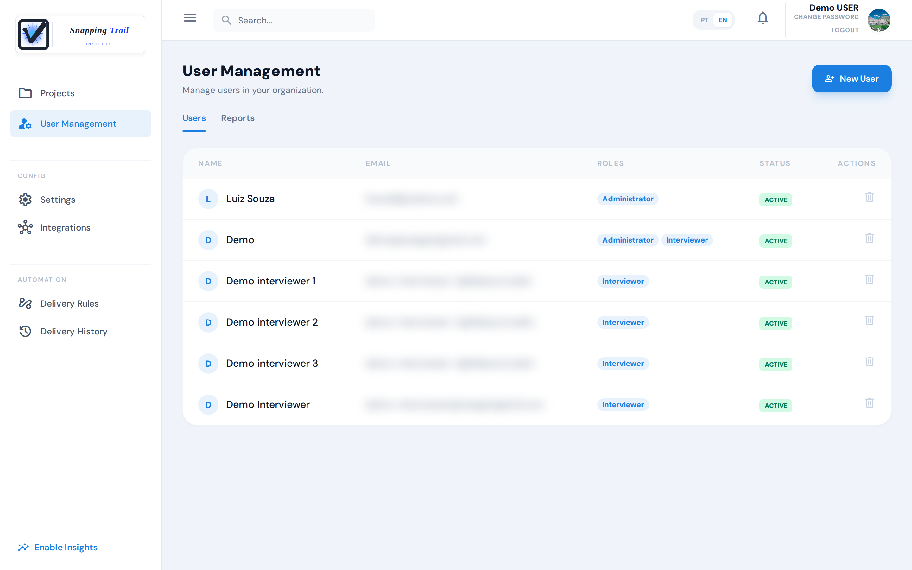
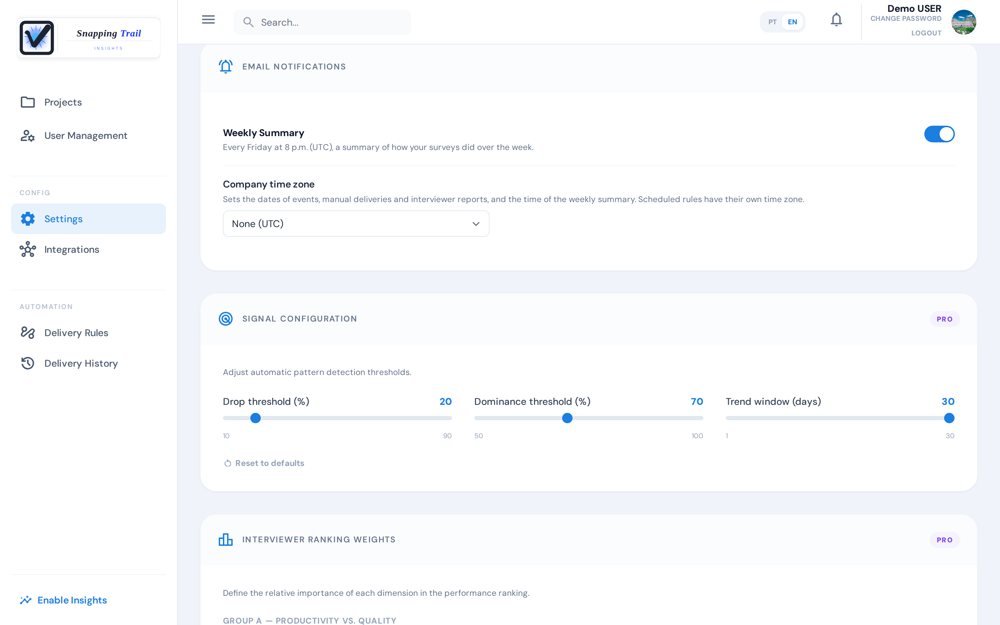
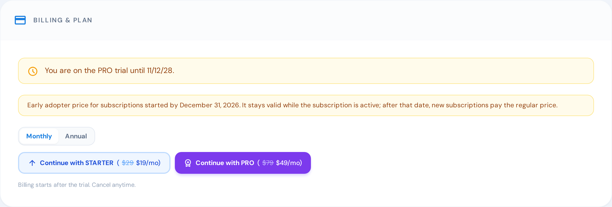

An administrator manages the account's users, settings and plan. Everyone else sees the settings, but only an administrator can change them.

## Users

Under **User Management**, an administrator sees everyone on the account: name, email, roles and status.

### Add a user

1. Click **New User**.
2. Fill in the name and the email, and choose the roles.
3. Click **Create User**.

An interviewer gets an email with a temporary password and a link to activate the account. On the first sign-in, they confirm the email and choose their own password. An email already on the account, as a team member or a respondent, cannot be used again.

### Roles

**New User** offers two roles, **Administrator** and **Interviewer**. A user can have both.

| Role | What they see and do |
|---|---|
| **Administrator** | Everything: users, **Integrations**, **Delivery Rules**, the plan, saving the settings, and creating and editing surveys |
| **Manager**, **Coordinator**, **Analyst** | Projects, objectives, results, reports, exports and the **Delivery History**. They create and edit projects, and see the settings without changing them |
| **Interviewer** | Only **My Surveys**: the projects they are a member of, where they start interviews of active surveys and see the interviews they made. The same in the Collect app |

**Manager**, **Coordinator** and **Analyst** are not offered under **New User**.

### Give an interviewer access to a project

Access is by project: an interviewer sees every survey of the projects they are a member of.

1. Open the project and its **User Management** tab.
2. Click **Add Existing Member** and choose the user, or **Create New User** to create one straight into the project.

The interviewer gets an email saying they were added. **Remove from Project** takes them out of it.

### Delete a user

The bin on a user's row deletes them. The user loses access immediately, and it cannot be undone. A user who took part in an interview cannot be deleted: their interviews stay on the account.

## Settings

Under **Settings**, an administrator changes the account's preferences and clicks **Save Settings**. **Discard** drops what was not saved.

### Company time zone

**Company time zone** sets the dates of events, manual deliveries and interviewer reports, and the time of the weekly summary. Without one (**None (UTC)**), those dates are in UTC. Scheduled delivery rules have their own time zone.

### Weekly summary

With **Weekly Summary** on, every Friday at 8 p.m., in the company's time zone, the administrator who created the account gets an email with how the surveys did over the week. It is available on every plan, and it starts off.

### Signal thresholds

**Signal Configuration** adjusts when the automatic signals appear. It needs the Pro plan; on the other plans, the defaults apply.

| Setting | What it changes | Range | Default |
|---|---|---|---|
| **Drop threshold (%)** | The drop rate from which a drop signal appears | 10% to 90% | 20% |
| **Dominance threshold (%)** | The share from which one answer counts as dominant | 50% to 100% | 70% |
| **Trend window (days)** | The length of the two periods compared: the last days against the same number before them | 1 to 30 days | 30 days |

**Reset to defaults** brings back the defaults.

### Interviewer ranking weights

**Interviewer Ranking Weights** sets how much each part counts in the interviewers' ranking. It needs the Pro plan.

- **Group A — Productivity vs. Quality**: **Productivity** and **Quality**, half each by default.
- **Group B — Quality Components**: **Completion**, **Low outliers** and **Text richness**, a third each by default.

Each group's weights add up to 100%, and each weight is at least 5%.

### Legal

**Legal** has the documents your company accepted: **Terms of Service**, **Responsibility Terms** and **Privacy Policy**. Each one shows its version and the date it has been in force since.

## Billing and plan

**Billing & Plan**, under **Settings**, shows the plan and its status. Only an administrator can change the plan; everyone else sees "To change the plan, contact your account administrator."

### The trial

A new account starts with a 14-day trial with every Pro feature, and 200 completed interviews for the whole trial. In the last three days, **Settings** shows how many are left.

When the trial ends, you have 7 more days to choose a plan, still with Pro. After that, the account goes on with the Free plan's features and limits.

### When a payment fails

When a renewal cannot be charged, the plan stays as it is for 7 days, and **Billing & Plan** says **Payment failed**. **Update payment method** opens the payment page. If nothing is paid by then, the account goes on with the Free plan.

### Change or cancel the plan

- In the trial, or without a plan: **Continue with** Starter or Pro opens the payment page.
- With a plan: **Switch to** the other plan, or **Cancel plan**. A cancelled plan stays until the end of the period already paid, and **Reactivate plan** brings it back.

After moving to a smaller plan, the surveys already active stay active. Only a new activation over the plan's limit is refused.

### What each plan includes

| | Free | Starter | Pro |
|---|---|---|---|
| Completed interviews per month | 100 | 1,500 | 5,000 |
| Active surveys | 2 | 30 | Unlimited |
| Integrations | Google Sheets | Google Sheets, Slack, Notion and Webhook | Google Sheets, Slack, Notion and Webhook |
| Signal thresholds and ranking weights | — | — | ✓ |
| Rows per export | 500 | 10,000 | Unlimited |
| Watermark on exports | Yes | No | No |

The full export of the account's history has no row limit and no watermark, on every plan.

**Completed Interviews Usage** shows how many interviews were completed in the period. Administrators get an email at 80% and at 100% of the plan's interviews. At 120%, collection by link and on the web stops until the next period. On a paid plan the period starts on the billing day; on Free, it is the calendar month.

## Export the account's history

**Customer History**, under **Settings**, is for administrators, managers, coordinators and analysts:

- **PDF**: the account's usage summary and the surveys' activity timeline.
- **Need all responses? Full export →**: the usage, the timeline and every interview's answers, in a file to download. The link expires after 48 hours; after that, generate a new one.

## Next steps

- [Frequently asked questions](../faq)
