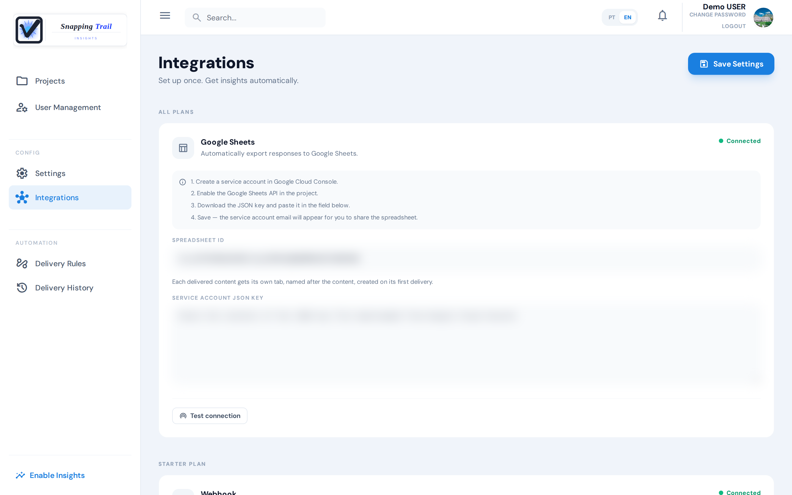
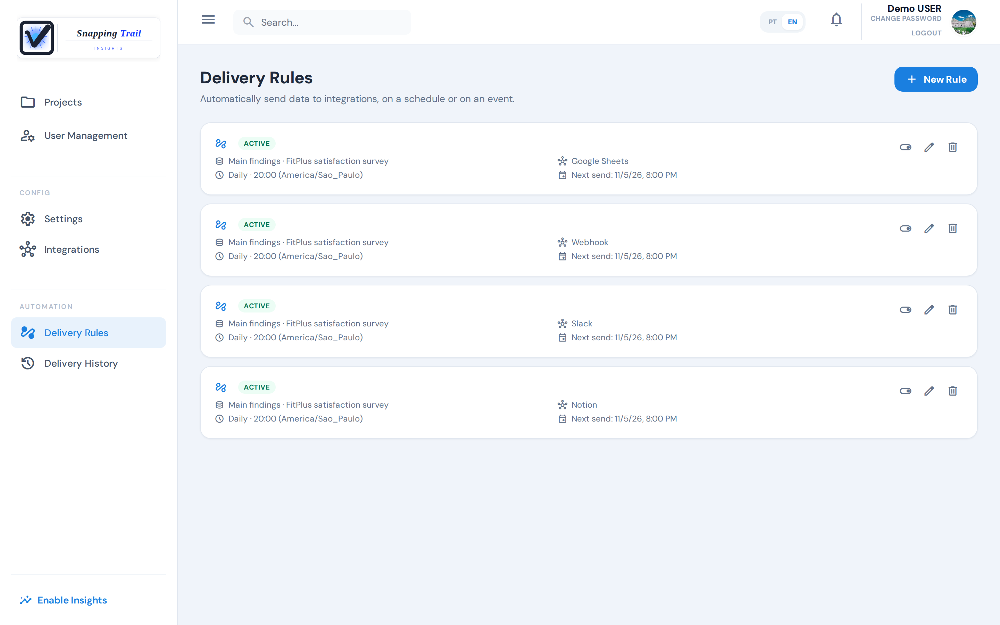
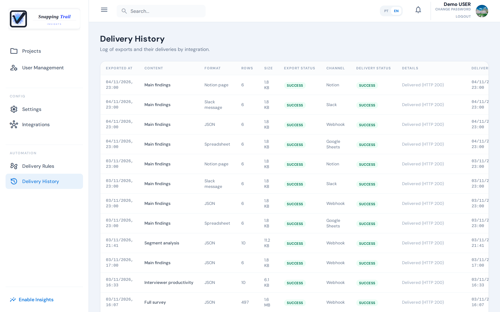

Snapping Trail can send your results to the tools your team already uses, on a schedule or when something happens, with no one having to download a report.

## Destinations

An administrator connects them under **Integrations**:

| Destination | What it gets | Plan |
|---|---|---|
| Google Sheets | One tab per content, with readable columns and real dates, ready for pivot tables and dashboards | Every plan |
| Slack | A short message for the team: the findings, the counts and a link back to the app | Starter and Pro |
| Notion | A dated section added to a page: the summary, and the data in a "See the data" toggle | Starter and Pro |
| Webhook | A JSON message, signed if you set a secret, for your own systems | Starter and Pro |

Each destination has a button to check it before any rule uses it: **Test connection** for Google Sheets and Notion, **Send test message** for Slack and **Connect** for the webhook. **Save Settings** keeps what you typed.

### Google Sheets

1. Create a service account in the Google Cloud Console, and enable the Google Sheets API in its project.
2. Download the account's JSON key and paste it into **Service account JSON key**. Once saved, the key is never shown again.
3. Paste the spreadsheet's **Spreadsheet ID**, the part of its address between `/d/` and `/edit`.
4. Share the spreadsheet as an editor with the service account's email, the `client_email` in the JSON key.

Each content gets its own tab, named after it, created on its first delivery.

### Slack

Create an incoming webhook in Slack for the channel, and paste its address into **Slack Webhook URL**.

### Notion

Create an integration in Notion, share the page with it, and fill in its **API Key** and the **Page ID**. Each delivery adds a dated section to that page. With a **Database ID** instead of a page, each delivery becomes a row of the database.

### Webhook

Give the **Webhook URL** that will receive the messages and, ideally, a secret in **Secret (optional)**: **Generate secret** creates one. With it, every message is signed, so your system can check that it came from Snapping Trail. Without one, the card warns that the messages are unsigned. **See format and signature** shows the message format and how to check the signature.

## Delivery rules

Under **Delivery Rules**, an administrator chooses what to send, to which integration and when:

- **Scheduled**: **Daily**, **Weekly** or **Monthly**, at an hour in the rule's own time zone. A monthly rule on a day the month does not have is sent on its last day.
- **Event-driven**: when something happens (see below).

What a rule can send:

| Content | What it has | Scheduled | Event-driven | Plan |
|---|---|---|---|---|
| Main findings | The survey's findings, as the screen shows them on your plan | ✓ | ✓ | Free |
| Highlights by question | One line per question: what the card says and its strength | ✓ | ✓ | Free |
| Segment differences | Each segment against the others, with the 95% range and each segment's rate | ✓ | ✓ | Pro |
| Interview list | The interviews collected since the rule's previous run | ✓ | — | Free |
| Interview responses | The answers of those interviews | ✓ | — | Free |
| Company signals | The signals of the company's active objectives | ✓ | ✓ | Pro |
| Sample reached | A JSON notice that a survey reached its minimum sample | — | ✓ | Pro |

A scheduled rule with main findings, highlights or segment differences names its survey. The events are:

- **A survey reaches its minimum for analysis**, once per survey: main findings, highlights and segment differences are sent for that survey, and so is the sample reached notice.
- **An interview is completed**: company signals are sent a minute after the last completed interview, and only if they changed.

Each destination gets the content in its own form; there is no format to choose. A delivery shows what your plan shows at that moment, and says how many findings the Pro plan would add.

When there is nothing new, nothing is sent, and the history says **Nothing new in the period**.

### Send a report now

On a survey's **Reports** tab, a report card's webhook button sends that report to your webhook straight away, in JSON. It needs the Starter or Pro plan and a configured webhook.

## Delivery history

**Delivery History** lists every export and its delivery: when, what, in which format, to which channel, and how it went. Administrators, managers, coordinators and analysts can see it.

The **Details** column says what the destination answered, in plain words:

- **Delivered (HTTP 200)**: the destination accepted it.
- **Destination refused access; check the credentials**, **Address not found; check the URL** or **Destination redirected; check the URL**: fix the integration.
- **Destination did not respond in time**, **No response from the destination** or **Error at the destination**: the destination was unavailable.
- For Google Sheets and Notion, it also says when a cell or the spreadsheet passed a Google Sheets limit (nothing was written), or when a Notion section was written without its data.

When the destination is unavailable, slow or asks to wait, the delivery is tried again on its own, up to three times a few seconds apart. When it refuses (a wrong credential or address), it is not tried again. A failed delivery is not sent again later: fix the integration, and the rule's next run goes through. The interviews of a failed run of an interview list or responses rule are not sent again.

## Next steps

- [Manage users, plan and settings](../administration)
