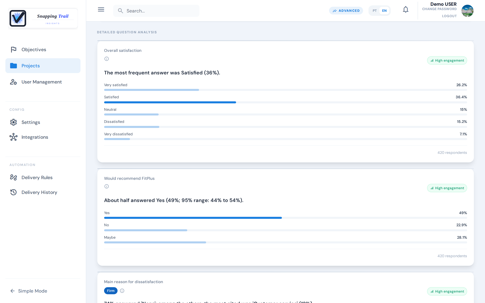
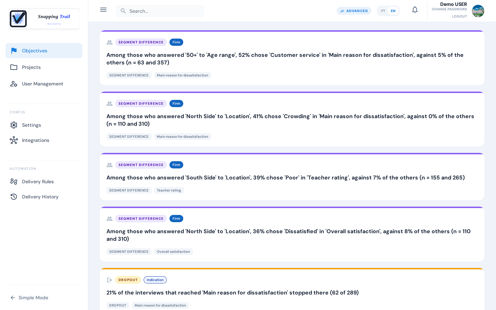
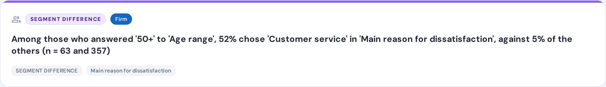
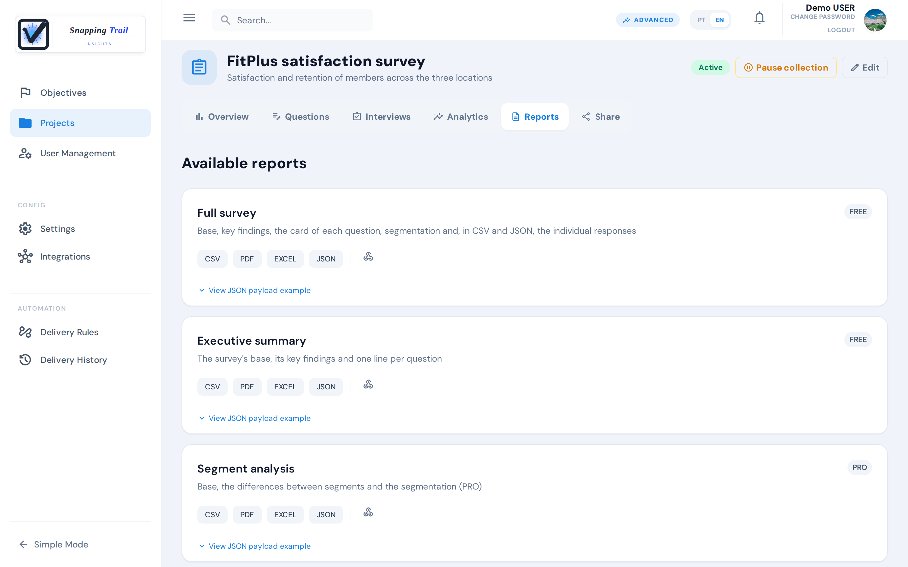

Snapping Trail does more than count answers: it tells you which differences between groups are firm, which are only indications, and where people drop out.

## Where to find your results

- **A survey's Analytics tab**: the totals, the answers to every question, the survey's findings, and filters by segment.
- **A research objective's Insights tab**: the main findings of the surveys behind a decision. Objectives appear when you choose **Enable Insights**, at the bottom of the left menu, and disappear with **Simple Mode** (see [Getting started](../getting-started)).

## The Analytics tab

At the top, **Responses**, **Minimum**, **Target** and **Target progress**. Below them:

- **Consistency**: whether the answers vary between segments by 15 points or more ("Variation detected"), do not ("No supported variation"), or there is not enough data yet ("Insufficient data").
- **Insights**: the survey's findings (see below).
- **Filter by segment**: the answers of one group only, for example one location or one age range.
- **Global Distribution**: each question's answers as bars, with the share and the count of each option.
- **Detailed question analysis**: one card per question.

### Answer cards

Each card shows the share of each answer. In a choice question, the options come in the order you wrote them; in the others (text, number, rating), the most chosen first. The most chosen option is highlighted, and an option nobody chose is not listed. Only completed interviews count; a question someone skipped is left out.

In a multiple choice question, the shares are of the people who answered it, so they can add up to more than 100%: the card says "Each respondent could mark more than one option."

With fewer than 5 respondents, the card says **Insufficient sample**. Otherwise it gives the **95% range** of the most chosen option: the interval where its true share very likely lies.

## Main findings

The main findings are the few things in your data most worth your attention, written in plain words. There are three kinds:

- **Segment difference**: a group answers differently from the rest of the sample. For example: "Among those who answered '50+' to 'Age range', 52% chose 'Customer service' in 'Main reason for dissatisfaction', against 5% of the others (n = 63 and 357)."
- **Dropout**: many respondents stop at the same question. For example: "21% of the interviews that reached 'Main reason for dissatisfaction' stopped there (62 of 289)."
- **Trend**: an answer is becoming more or less common. For example: "In the last 30 days, 'No' in 'Intends to renew' went from 15% to 36% (n = 201 and 219)."

A **Summary** card ("Main findings") brings the strongest ones together, with the number of completed and interrupted interviews and the quality of the sample.

At most 6 findings are shown, firm ones first. Options that mean "none" or "not applicable" are never the subject of a finding.

### Firm or indication

Every finding comes with its strength:

- **Firm**: you can act on it.
- **Indication**: it may be real, but the sample is not yet large enough to be sure. Watch it as more answers come in. At most 2 indications are shown.

Behind this is the 95% range of the difference: the interval where the true difference very likely lies. A segment difference or a trend is **firm** when even the low end of that range is 15 points or more, and an **indication** when the difference is 15 points or more but the low end is closer to zero. A dropout is firm when even the low end of its rate's range is 30% or more. A segment difference needs at least 5 respondents in the group and in the rest of the sample.

## Signals

An objective's **Signals** tab lists, survey by survey, everything the analysis detected, with its severity. Where a finding compares a group with the rest of the sample, a signal compares two groups with each other: for example, '50+' with '35–49'.

## What each plan shows

| | Free and Starter | Pro |
|---|---|---|
| Dropout | ✓ | ✓ |
| Segment differences | — | ✓ |
| Trends | — | ✓ |

The trial shows everything Pro shows. On Free and Starter, the screen and the reports say how many findings the Pro plan would show, without showing them: for example, "2 more findings (segment differences and trend) available on the PRO plan."

## Reports

Download reports as **CSV**, **PDF**, **EXCEL** or **JSON**. Each report shows the lowest plan that has it:

| Report | Where | What it has | Plan |
|---|---|---|---|
| Full survey | The survey's **Reports** tab | Base, key findings, the card of each question, segmentation and, in CSV and JSON, the individual responses | Free |
| Executive summary | The survey's **Reports** tab | The survey's base, its key findings and one line per question | Free |
| Segment analysis | The survey's **Reports** tab | Base, the differences between segments and the segmentation | Pro |
| Objective report | The objective's **Reports** tab | Context, base by survey, key findings, sample quality and recurrence across surveys | Pro |
| Interviewer productivity | **User Management**, **Reports** tab | Productivity, quality and ranking of the interviewers (CSV, PDF and JSON) | Pro |

Reports show exactly what your plan shows on screen.

## Next steps

- [Send your results to other tools](../integrations)
