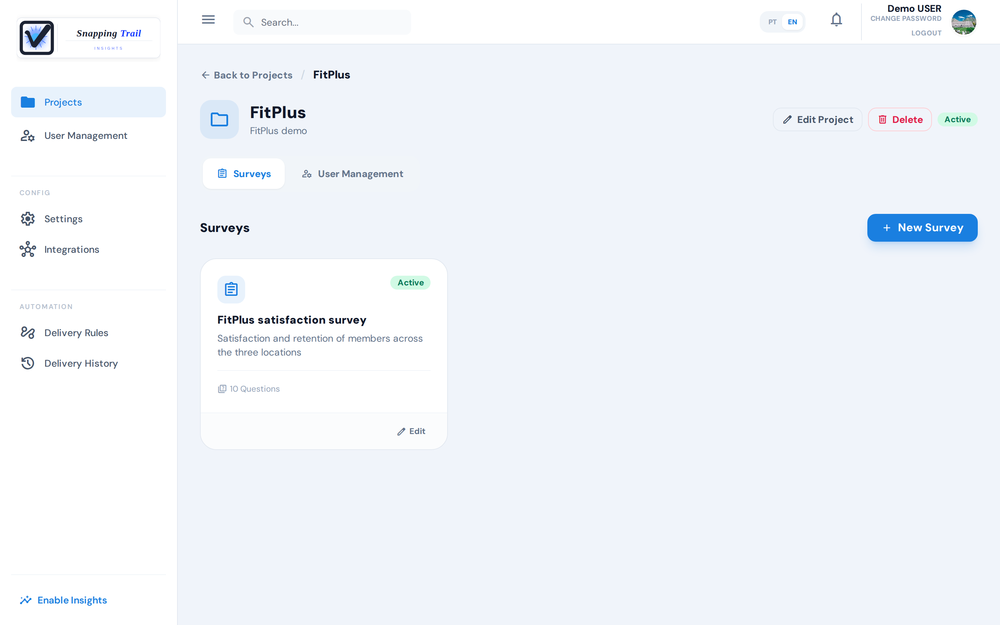
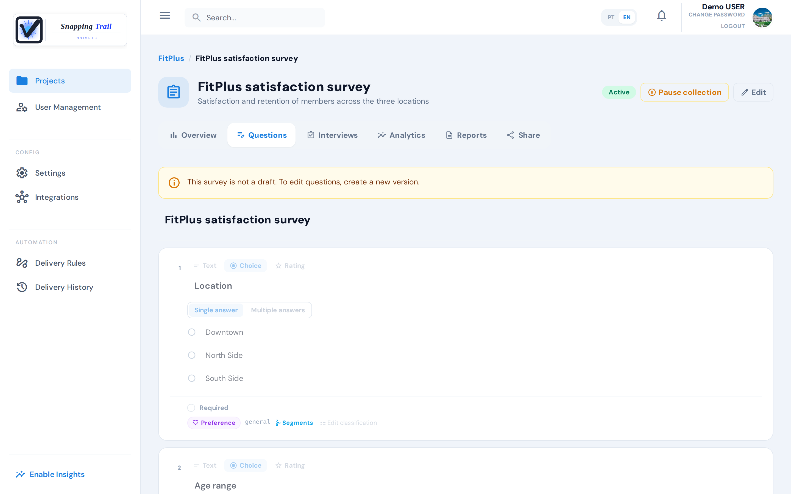
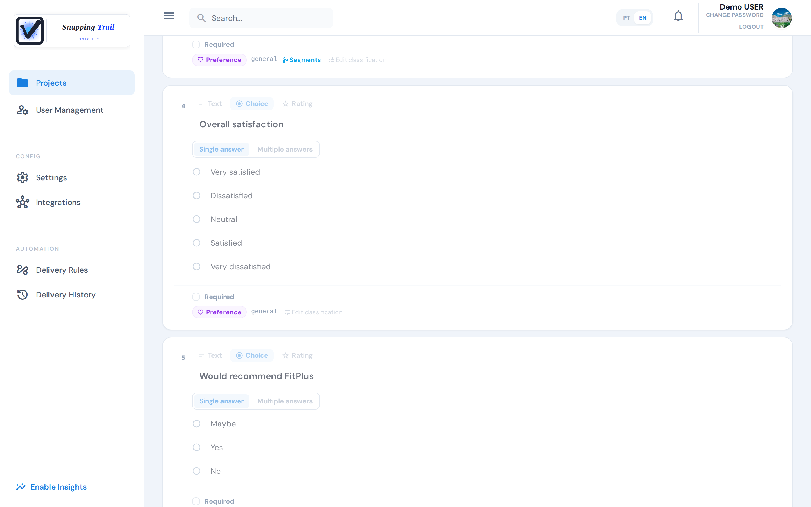

A survey is the questionnaire your respondents answer. Surveys live inside a **project**, and a project can hold several surveys about the same subject.

Only **administrators** create and edit surveys. Interviewers see the active surveys of their projects under **My Surveys**.

## Create a survey

1. Open **Projects** and choose a project.
2. Choose **New Survey**. Give it a **Survey Title** and, if you want, a **Description**, then choose **Create Survey**.
3. Add questions with **Text**, **Choice** or **Rating**.

A new survey starts as a draft. **Save** keeps your work; **Publish** makes the survey active.

## Question types

| Type | What it measures |
|---|---|
| **Text** | A free answer in the respondent's own words: an opinion, a reason, a comment. |
| **Choice**, with **Single answer** | One option out of a list, such as the location or the plan. |
| **Choice**, with **Multiple answers** | Every option that applies, such as the services someone uses. |
| **Yes/No** | A plain yes or no. The shortcut fills in the options **Yes** and **No**. |
| **Likert** | Agreement with a statement. The shortcut fills in five options, from "Strongly disagree" to "Strongly agree". |
| **Rating** | A score on a scale, under **Answer scale**. |

For a **Rating** question, pick one of the presets or set your own scale:

| Preset | Scale | What it measures |
|---|---|---|
| **NPS** | 0 to 10 | How likely someone is to recommend you |
| **CSAT** | 1 to 5 | How satisfied someone is |
| **CES** | 1 to 7 | How easy something was to do |
| **Custom** | Your **Minimum**, **Maximum** and **Step** | Any other score |

Tick **Required** when every completed interview must answer the question. The answer is checked when the interview is completed, and only for the questions the respondent was shown.

## Follow-up questions

In any choice question (Single answer, Multiple answers, Yes/No or Likert), each option can open a **follow-up question**, shown only to those who chose that option. For example, "Main reason for dissatisfaction" can appear only to those who answered "Dissatisfied"; everyone else never sees it.

Next to the option, choose **Follow-up** and write the question. The follow-up is answered with free text. Tick **Required when shown** if those who see it must answer it.

## Status

| Status | What it means |
|---|---|
| Draft | Being built. Nobody can answer it yet. |
| Active | Open for answers. A survey needs at least one question to become active. |
| Inactive | Closed for new interviews. Interviews already started can still be completed, and the answers are kept. |
| Archived | Out of the way, with everything it collected. It takes no answers. |

**Pause collection** turns an active survey inactive, and **Resume collection** opens it again. A paused survey stays in its objective's insights: pausing keeps what was collected.

## Archive and restore a survey

**Archive** takes an active or inactive survey out of the way without deleting anything. The app asks first. Once archived, the survey:

- takes no answers, through a link, a QR code or the Collect app;
- leaves the lists, of the web app and of the Collect app (tick **Show archived** to see it again in the web app);
- no longer counts toward your plan's active surveys;
- leaves its objective's insights, signals and reports (see [Results](../results));
- keeps its answers, its own analysis and its reports;
- has its delivery rules turned off: the [Integrations](../integrations) rules list says **Off: the survey was archived**.

**Restore** brings it back inactive. Resuming it then counts toward your plan's active surveys, like any resume. Its delivery rules stay off: turn on again the ones you want.

Only the account administrator archives and restores a survey. Archiving its objective archives it too.

## Active surveys and your plan

Each plan allows a number of active surveys at a time (inactive and archived ones do not count): 2 on **Free**, 30 on **Starter**, and no limit on **Pro** (and during the trial). When your company already has that many, publishing a draft or resuming a paused survey is refused, and the app says, for example:

> The Free plan allows up to 2 active surveys at a time. Pause another survey, or upgrade to Starter, to activate this one.

Surveys that are already active stay active, even after a change to a smaller plan: only the next activation is refused.

## Change a survey that is no longer a draft

Once a survey leaves the draft, its questions can no longer change: the builder shows them read-only. You can still change the title and the description.

To change the questions, choose **New version**. It creates a new draft with a copy of the questions, which you edit and then publish. The earlier survey keeps its answers.

## Delete a survey

Only a draft with no answers can be deleted, and it is deleted for good. A survey that has been active is not deleted: pause its collection, or archive it to take it out of the way.

## Next steps

- [Collect answers through a link or a QR code](../collection)
- [Collect in the field with the Collect app](../collect-app)
