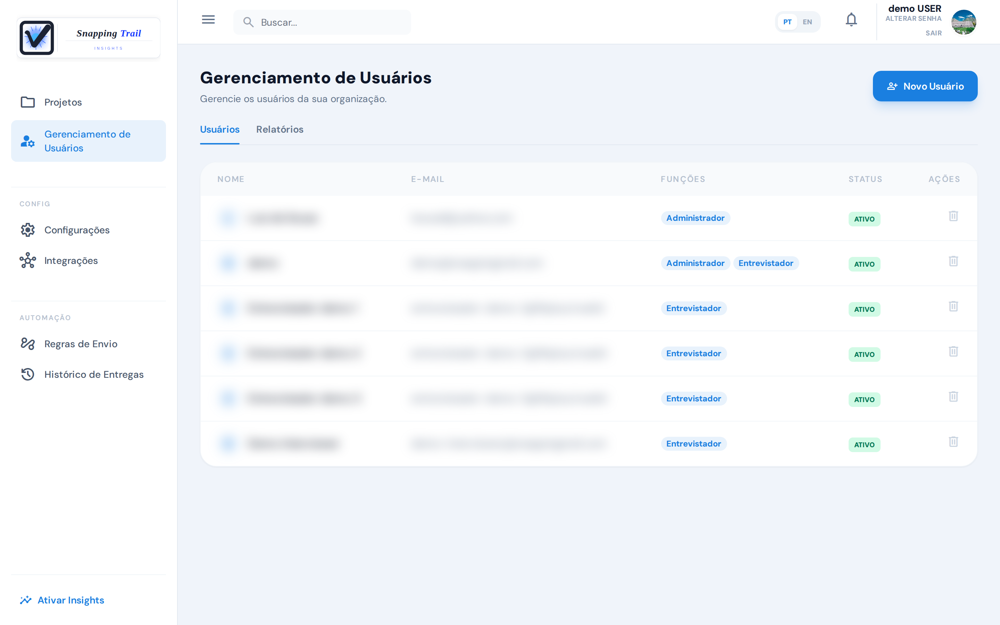
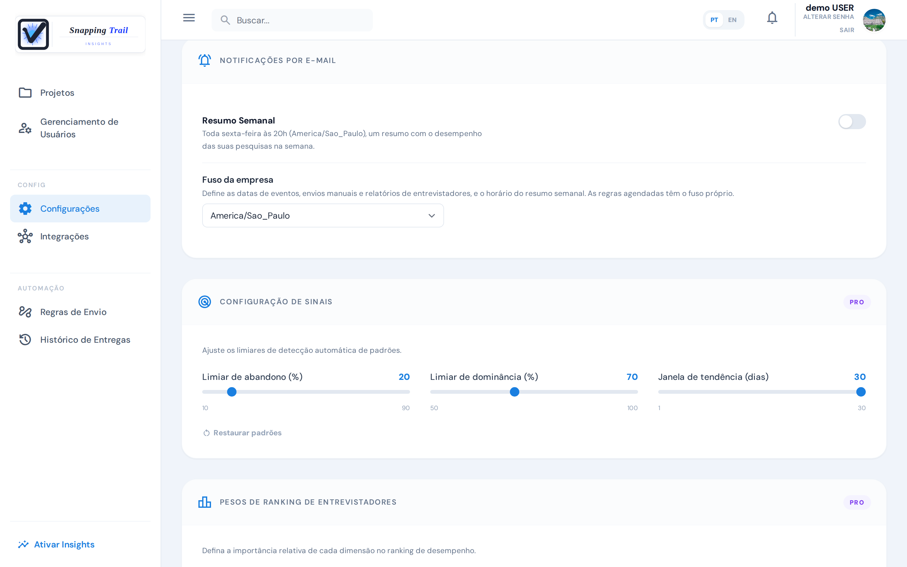
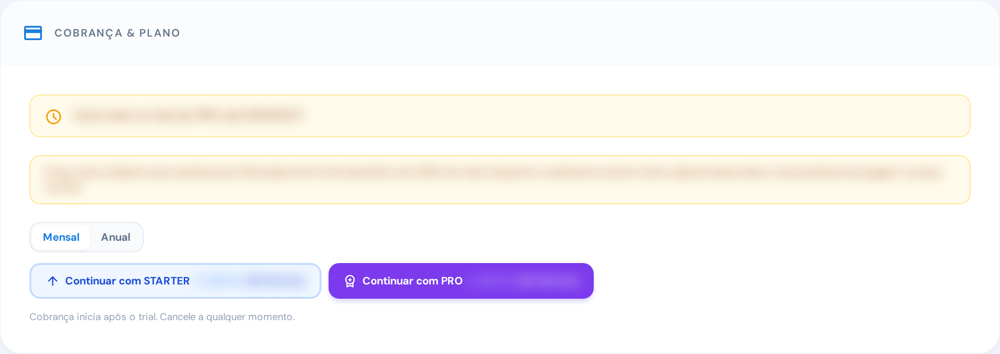

Um administrador cuida dos usuários, das configurações e do plano da conta. Os demais veem as configurações, mas só um administrador as muda.

## Usuários

Em **Gerenciamento de Usuários**, um administrador vê todos da conta: nome, e-mail, funções e status.

### Adicione um usuário

1. Clique em **Novo Usuário**.
2. Preencha o nome e o e-mail, escolha as funções e o status: **Ativo** ou **Inativo**.
3. Clique em **Criar Usuário**.

Um usuário ativo, administrador ou entrevistador, recebe um e-mail com uma senha temporária e um link para ativar a conta. No primeiro acesso, ele confirma o e-mail e escolhe a própria senha. Um usuário criado inativo não consegue entrar, e recebe esse e-mail quando você o reativa. Um e-mail que já está na conta, na equipe ou entre os respondentes, não pode ser usado de novo.

### Funções

**Novo Usuário** oferece duas funções, **Administrador** e **Entrevistador**. Um usuário pode ter as duas.

| Função | O que vê e faz |
|---|---|
| **Administrador** | Tudo: usuários, **Integrações**, **Regras de Envio**, o plano, salvar as configurações, e criar e editar pesquisas |
| **Entrevistador** | Só **Minhas Pesquisas**: os projetos de que é membro, onde inicia entrevistas das pesquisas ativas e vê as entrevistas que fez. O mesmo no app Collect |

### Dê a um entrevistador acesso a um projeto

O acesso é por projeto: o entrevistador vê todas as pesquisas dos projetos de que é membro.

1. Abra o projeto e a aba **Gerenciamento de Usuários** dele.
2. Clique em **Adicionar Membro Existente** e escolha o usuário, ou em **Criar Novo Usuário** para criar um já no projeto.

O entrevistador recebe um e-mail avisando que foi adicionado. **Remover do Projeto** o tira do projeto. Um usuário inativo não aparece para ser adicionado.

### Desative e reative um usuário

**Desativar**, na linha de um usuário, pede confirmação e tira o acesso dele: ele não consegue mais entrar, e as sessões abertas dele são encerradas. As entrevistas e os relatórios de entrevistadores continuam como estão. **Reativar** devolve o acesso.

As entrevistas que ainda estão pendentes no celular de um entrevistador desativado ficam guardadas no app Collect e vão quando ele for reativado e entrar de novo.

### Exclua um usuário

A lixeira na linha de um usuário o exclui. Ele perde o acesso na hora, e não há como desfazer. Um usuário que participou de uma entrevista não pode ser excluído: desative-o, e as entrevistas dele continuam na conta.

### O que é protegido

- Ninguém exclui nem desativa o próprio usuário.
- A conta sempre mantém um administrador ativo: o único que resta não pode ser excluído nem desativado.

Nessas linhas, um cadeado aparece no lugar dos botões e diz o motivo.

## Configurações

Em **Configurações**, um administrador muda as preferências da conta e clica em **Salvar Configurações**. **Descartar** desfaz o que não foi salvo.

### Fuso da empresa

O **Fuso da empresa** define as datas de eventos, envios manuais e relatórios de entrevistadores, e o horário do resumo semanal. Sem fuso (**Nenhum (UTC)**), essas datas ficam em UTC. As regras de envio agendadas têm o fuso próprio.

### Resumo semanal

Com o **Resumo Semanal** ligado, toda sexta-feira às 20h, no fuso da empresa, o administrador que criou a conta recebe um e-mail com o desempenho das pesquisas na semana. Ele está em todos os planos e começa desligado.

### Limites dos sinais

A **Configuração de Sinais** ajusta quando os sinais automáticos aparecem. Ela pede o plano Pro; nos outros planos, valem os padrões.

| Ajuste | O que muda | Faixa | Padrão |
|---|---|---|---|
| **Limiar de abandono (%)** | A taxa de abandono a partir da qual aparece um sinal de abandono | 10% a 90% | 20% |
| **Limiar de dominância (%)** | A parcela a partir da qual uma resposta conta como dominante | 50% a 100% | 70% |
| **Janela de tendência (dias)** | O tamanho dos dois períodos comparados: os últimos dias contra o mesmo número de dias antes deles | 1 a 30 dias | 30 dias |

**Restaurar padrões** volta aos padrões.

### Pesos do ranking de entrevistadores

Os **Pesos de Ranking de Entrevistadores** definem quanto cada parte conta no ranking dos entrevistadores. Eles pedem o plano Pro.

- **Grupo A — Produtividade vs. Qualidade**: **Produtividade** e **Qualidade**, metade cada por padrão.
- **Grupo B — Componentes de Qualidade**: **Completude**, **Baixos outliers** e **Riqueza textual**, um terço cada por padrão.

Os pesos de cada grupo somam 100%, e cada peso fica em pelo menos 5%.

### Legal

Em **Legal** estão os documentos que a sua empresa aceitou: **Termos de Uso**, **Termo de Responsabilidade** e **Política de Privacidade**. Cada um mostra a versão e a data desde a qual vale.

## Cobrança e plano

**Cobrança & Plano**, em **Configurações**, mostra o plano e a situação dele. Só um administrador muda o plano; os demais veem "Para alterar o plano, fale com o administrador da conta."

### O período de teste

Uma conta nova começa com 14 dias de teste com todos os recursos do Pro, e 200 entrevistas concluídas para o teste inteiro. Nos últimos três dias, **Configurações** mostra quantos faltam.

Quando o teste acaba, você tem mais 7 dias para escolher um plano, ainda com o Pro. Depois disso, a conta continua com os recursos e os limites do plano Free.

### Quando um pagamento falha

Quando a renovação não pode ser cobrada, o plano continua como está por 7 dias, e **Cobrança & Plano** avisa **Pagamento não processado**. **Atualizar forma de pagamento** abre a página de pagamento. Se nada for pago até lá, a conta continua com o plano Free.

### Mude ou cancele o plano

- No teste, ou sem plano: **Continuar com** Starter ou Pro abre a página de pagamento.
- Com um plano: **Mudar para** o outro plano, ou **Cancelar plano**. Um plano cancelado vale até o fim do período já pago, e **Reativar plano** o traz de volta.

Depois de passar para um plano menor, os usuários, os projetos e as pesquisas ativas que você já tem continuam. Só acrescentar mais um acima do limite do plano é recusado: criar ou reativar um usuário, criar um projeto, ativar uma pesquisa.

### O que cada plano inclui

| | Free | Starter | Pro |
|---|---|---|---|
| Entrevistas concluídas por mês | 100 | 1.500 | 5.000 |
| Usuários ativos | 4 | 16 | Sem limite |
| Projetos | 1 | Sem limite | Sem limite |
| Pesquisas ativas | 2 | 30 | Sem limite |
| Integrações | Google Sheets | Google Sheets, Slack, Notion e Webhook | Google Sheets, Slack, Notion e Webhook |
| Limites dos sinais e pesos do ranking | — | — | ✓ |
| Linhas por exportação | 500 | 10.000 | Sem limite |
| Marca d'água nas exportações | Sim | Não | Não |

Usuários inativos não contam no limite de usuários ativos. A exportação completa do histórico da conta não tem limite de linhas nem marca d'água, em todos os planos.

O **Uso de Entrevistas Concluídas** mostra quantas entrevistas foram concluídas no período. Os administradores recebem um e-mail em 80% e em 100% das entrevistas do plano. Em 120%, a coleta por link e pela web para até o próximo período. Num plano pago, o período começa no dia da cobrança; no Free, é o mês do calendário.

## Exporte o histórico da conta

O **Histórico do Cliente**, em **Configurações**, exporta o que a conta tem:

- **PDF**: o resumo de uso da conta e a linha do tempo de atividade das pesquisas.
- **Precisa de todas as respostas? Exportação completa →**: o uso, a linha do tempo e as respostas de cada entrevista, num arquivo para baixar. O link expira em 48 horas; depois disso, gere outro.

## Encerre a conta

Para encerrar a conta, peça ao suporte.

## Próximos passos

- [Perguntas frequentes](../faq)
