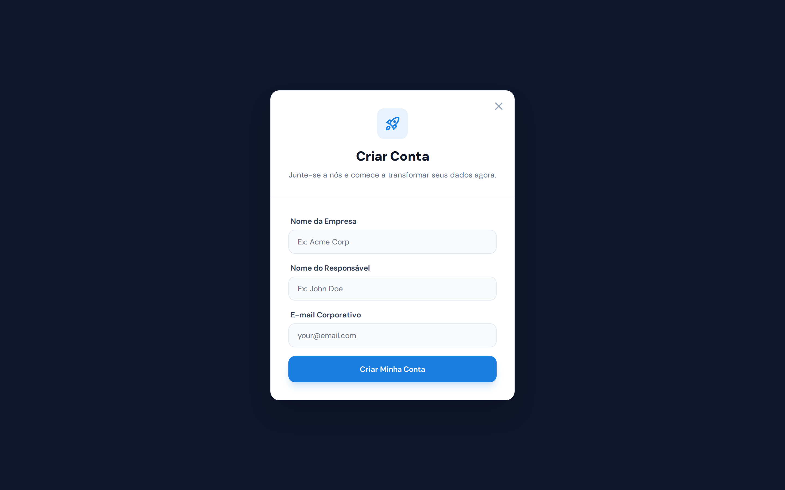
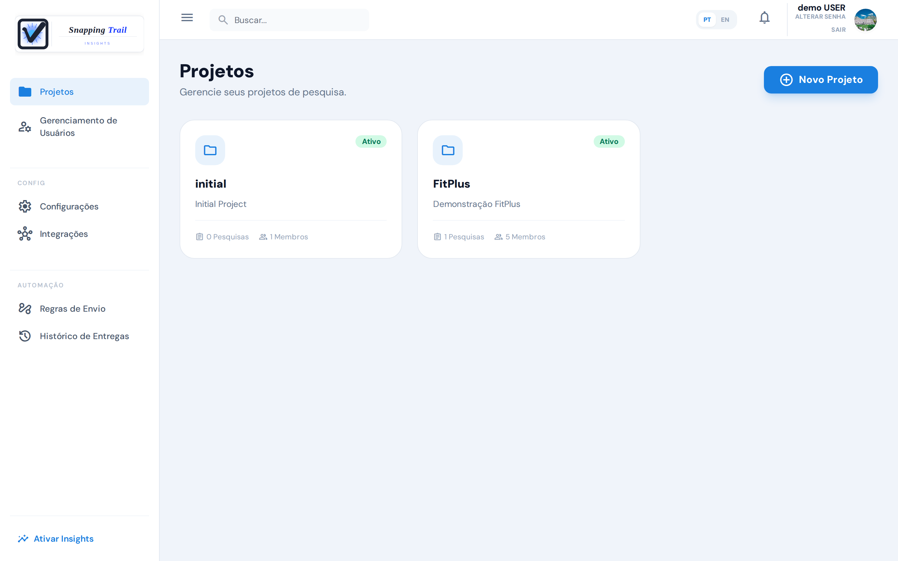

O Snapping Trail ajuda você a planejar uma pesquisa, coletar respostas em campo ou on-line e ver o que os dados dizem: quais diferenças entre grupos são firmes, quais são só indícios, e onde as pessoas desistem.

Esta página leva você da criação da conta até a primeira pesquisa.

## Crie sua conta

1. No site do Snapping Trail, escolha **Criar conta**.
2. Informe o nome da sua empresa, o seu nome e o seu e-mail de trabalho.
3. Abra o e-mail de ativação e defina a sua senha.
4. Entre pelo endereço da sua empresa, que vem no e-mail de boas-vindas (por exemplo, `suaempresa.app.snappingtrail.com`). Sua equipe entra pelo mesmo endereço.

No primeiro acesso, você aceita os **Termos de Uso** e o **Termo de Responsabilidade**, e vê a **Política de Privacidade**. Você pode relê-los a qualquer momento em **Configurações → Legal**.

## O período de teste

Toda conta nova começa com 14 dias de teste, com tudo o que o plano **Pro** oferece. No fim do teste, escolha um plano em **Configurações → Cobrança & Plano**. Se não escolher, a conta continua no plano **Free**, e os seus dados ficam onde estão.

| | Free | Starter | Pro |
|---|---|---|---|
| Usuários | 4 | 16 | Ilimitados |
| Projetos | 1 | Ilimitados | Ilimitados |
| Pesquisas ativas | 2 | 30 | Ilimitadas |
| Entrevistas concluídas por mês | 100 | 1.500 | 5.000 |
| Coleta offline pelo app Collect | ✓ | ✓ | ✓ |
| Diferenças entre segmentos e tendências | — | — | ✓ |

Ao chegar perto da franquia do mês, você recebe um e-mail com 80% e outro com 100%. A coleta pelo link e pela web para em 120%. As entrevistas do app Collect são sempre aceitas.

## Quem faz o quê

- **Administradores** configuram a conta: usuários, integrações, regras de envio, o fuso da empresa e a assinatura. Também criam e editam pesquisas.
- **Entrevistadores** coletam respostas, no app Collect ou na web, e veem só as pesquisas atribuídas a eles.

Adicione pessoas em **Gerenciamento de Usuários**.

## Como se orientar

O menu da esquerda muda conforme o seu papel. No alto da tela, **PT / EN** troca o idioma.

Os objetivos de pesquisa, que agrupam pesquisas em torno de uma decisão que você precisa tomar, aparecem quando você liga **Ativar Insights**, no pé do menu da esquerda (veja [Resultados](../results)). Eles somem com **Modo Simples**. O selo **Avançado**, no alto, mostra em que modo você está.

Sua conta já vem com um primeiro projeto, **Meu primeiro projeto**. Você pode renomeá-lo ou criar outros.

## Defina o fuso da empresa

Em **Configurações**, um administrador escolhe o **Fuso da empresa**. Ele define as datas de eventos, envios manuais e relatórios de entrevistadores, e quando o resumo semanal é enviado: toda sexta-feira às 20h. Sem fuso, as datas ficam em UTC.

## Próximos passos

- [Crie a sua primeira pesquisa](../surveys)
- [Colete respostas por link ou QR Code](../collection)
- [Colete em campo com o app Collect](../collect-app)
