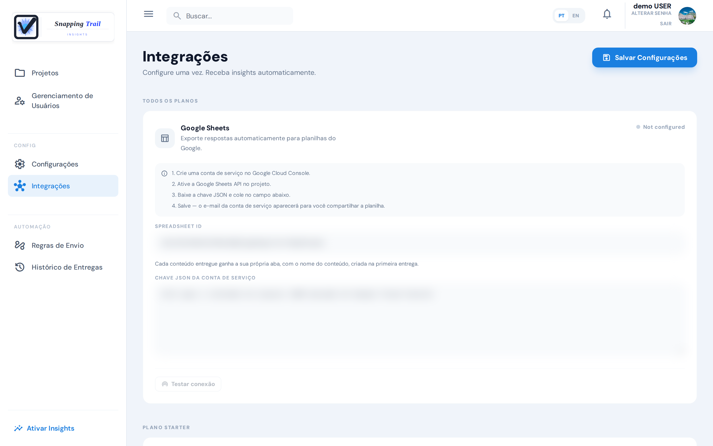
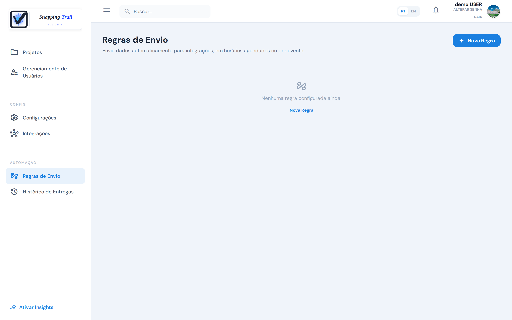
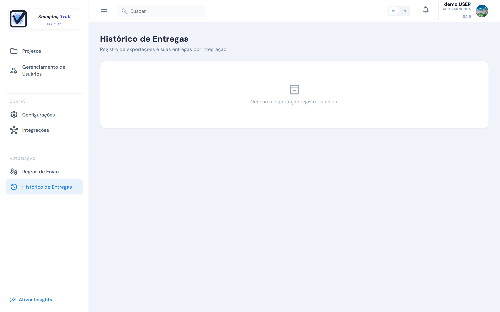

O Snapping Trail pode enviar os seus resultados para as ferramentas que a sua equipe já usa, num horário ou quando algo acontece, sem ninguém precisar baixar um relatório.

## Destinos

Um administrador os conecta em **Integrações**:

| Destino | O que recebe | Plano |
|---|---|---|
| Google Sheets | Uma aba por conteúdo, com colunas legíveis e datas de verdade, pronta para tabelas dinâmicas e painéis | Todos os planos |
| Slack | Uma mensagem curta para a equipe: os achados, as contagens e um link de volta ao app | Starter e Pro |
| Notion | Uma seção datada acrescentada a uma página: o resumo, e os dados num "Ver dados" | Starter e Pro |
| Webhook | Uma mensagem JSON, assinada se você definir um segredo, para os seus próprios sistemas | Starter e Pro |

Cada destino tem um botão para conferi-lo antes que alguma regra o use: **Testar conexão** no Google Sheets e no Notion, **Enviar mensagem de teste** no Slack e **Conectar** no webhook. **Salvar Configurações** guarda o que você digitou.

### Google Sheets

1. Crie uma conta de serviço no Google Cloud Console e ative a API do Google Sheets no projeto dela.
2. Baixe a chave JSON da conta e cole em **Chave JSON da conta de serviço**. Depois de salva, a chave nunca mais é mostrada.
3. Cole o **Spreadsheet ID** da planilha, a parte do endereço dela entre `/d/` e `/edit`.
4. Compartilhe a planilha, como editora, com o e-mail da conta de serviço, o `client_email` da chave JSON.

Cada conteúdo ganha a sua aba, com o nome dele, criada na primeira entrega.

### Slack

Crie no Slack um incoming webhook para o canal e cole o endereço dele em **URL do Webhook do Slack**.

### Notion

Crie uma integração no Notion, compartilhe a página com ela e preencha a **Chave da API** e o **ID da Página**. Cada envio acrescenta uma seção datada a essa página. Com um **ID do Database** no lugar da página, cada envio vira uma linha do database.

### Webhook

Informe a **URL do Webhook** que vai receber as mensagens e, de preferência, um segredo em **Segredo (opcional)**: **Gerar segredo** cria um. Com ele, toda mensagem vai assinada, e o seu sistema pode conferir que veio do Snapping Trail. Sem ele, o cartão avisa que as mensagens não são assinadas. **Ver formato e assinatura** mostra o formato das mensagens e como conferir a assinatura.

## Regras de envio

Em **Regras de Envio**, um administrador escolhe o que enviar, para qual integração e quando:

- **Agendado**: **Diário**, **Semanal** ou **Mensal**, numa hora no fuso da própria regra. Uma regra mensal num dia que o mês não tem é enviada no último dia do mês.
- **Por evento**: quando algo acontece (veja abaixo).

O que uma regra pode enviar:

| Conteúdo | O que traz | Agendado | Por evento | Plano |
|---|---|---|---|---|
| Principais achados | Os achados da pesquisa, como a tela os mostra no seu plano | ✓ | ✓ | Free |
| Destaques por pergunta | Uma linha por pergunta: o que o card diz e a força | ✓ | ✓ | Free |
| Diferenças entre segmentos | Cada segmento contra os demais, com a faixa de 95% e a taxa de cada segmento | ✓ | ✓ | Pro |
| Lista de entrevistas | As entrevistas coletadas desde a execução anterior da regra | ✓ | — | Free |
| Respostas das entrevistas | As respostas dessas entrevistas | ✓ | — | Free |
| Sinais da empresa | Os sinais dos objetivos ativos da empresa | ✓ | ✓ | Pro |
| Amostra atingida | Um aviso, em JSON, de que uma pesquisa atingiu a amostra mínima | — | ✓ | Pro |

Uma regra agendada com principais achados, destaques ou diferenças entre segmentos indica a pesquisa. Os eventos são:

- **Uma pesquisa atinge o mínimo para análise**, uma vez por pesquisa: vão os principais achados, os destaques e as diferenças entre segmentos dessa pesquisa, e também o aviso de amostra atingida.
- **Uma entrevista é concluída**: os sinais da empresa vão um minuto depois da última entrevista concluída, e só se mudaram.

Cada destino recebe o conteúdo na forma dele; não há formato para escolher. Um envio mostra o que o seu plano mostra naquele momento, e diz quantos achados o plano Pro acrescentaria.

Quando não há novidade, nada é enviado, e o histórico mostra **Sem novidades no período**.

### Envie um relatório agora

Na aba **Relatórios** de uma pesquisa, o botão de webhook de um relatório o envia na hora para o seu webhook, em JSON. Ele pede o plano Starter ou Pro e um webhook configurado.

## Histórico de Entregas

O **Histórico de Entregas** lista cada exportação e a entrega dela: quando, o quê, em qual formato, para qual canal e como foi. Administradores, gerentes, coordenadores e analistas podem vê-lo.

A coluna **Detalhes** diz o que o destino respondeu, em palavras simples:

- **Entregue (HTTP 200)**: o destino aceitou.
- **Destino recusou o acesso; confira a credencial**, **Endereço não encontrado; confira a URL** ou **Destino redirecionou; confira a URL**: corrija a integração.
- **Destino não respondeu a tempo**, **Sem resposta do destino** ou **Erro no destino**: o destino estava indisponível.
- No Google Sheets e no Notion, ela também diz quando uma célula ou a planilha passou de um limite do Google Sheets (nada foi escrito), ou quando uma seção do Notion foi escrita sem os dados.

Quando o destino está indisponível, lento ou pede para esperar, o envio é tentado de novo sozinho, até três vezes, com alguns segundos entre elas. Quando ele recusa (credencial ou endereço errado), não há nova tentativa. Um envio que falhou não é refeito depois: corrija a integração, e a próxima execução da regra passa. As entrevistas de uma execução que falhou, numa regra de lista ou de respostas das entrevistas, não são enviadas de novo.

## Próximos passos

- [Gerencie usuários, plano e configurações](../administration)
