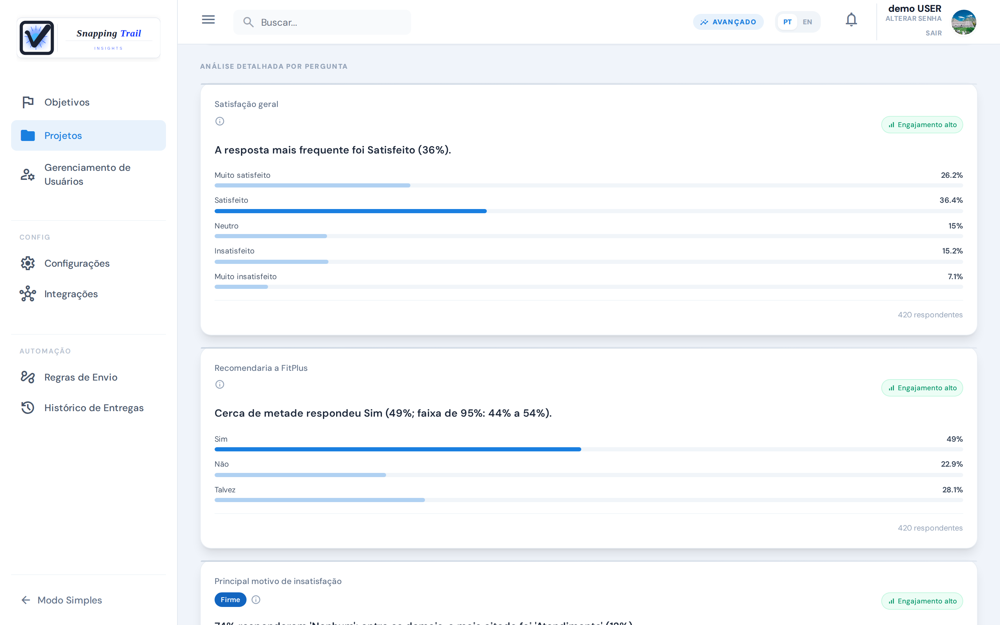
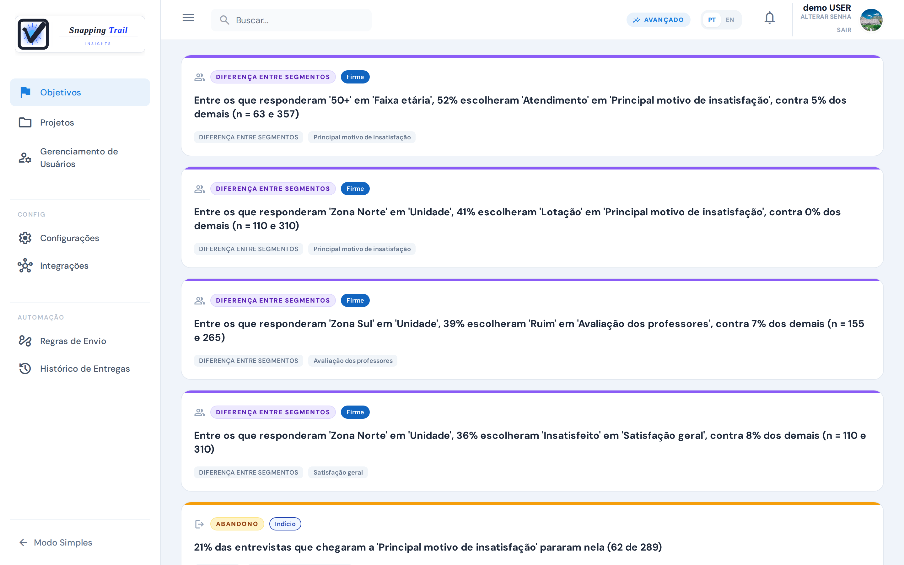
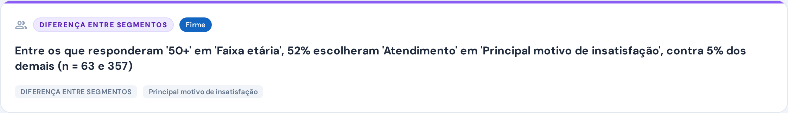
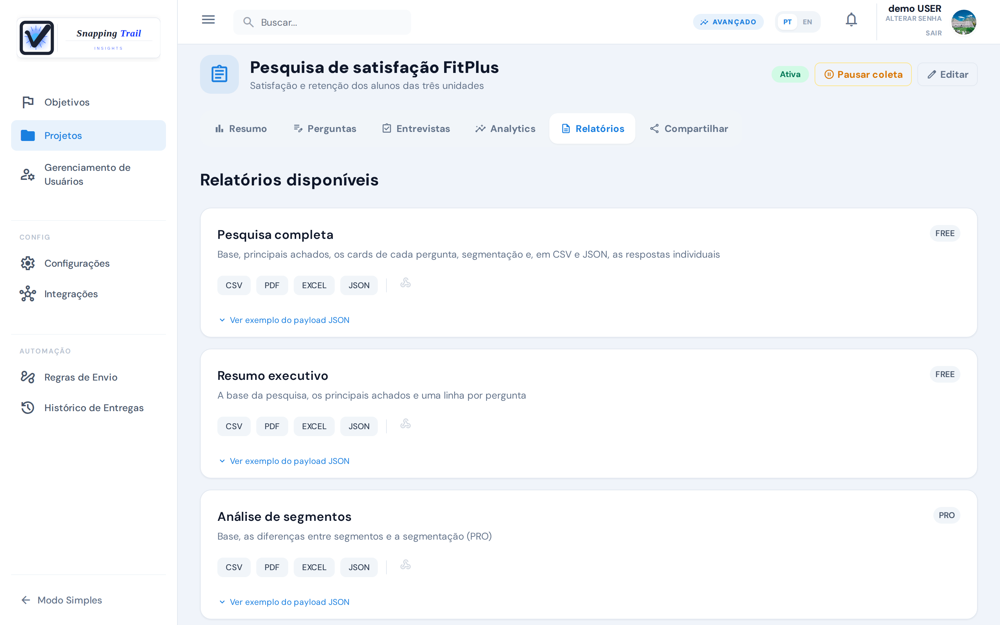

O Snapping Trail faz mais do que contar respostas: ele mostra quais diferenças entre grupos são firmes, quais são só indícios, e onde as pessoas desistem.

## Onde ver os resultados

- **A aba Analytics de uma pesquisa**: os totais, as respostas de cada pergunta, os achados da pesquisa e filtros por segmento.
- **A aba Insights de um objetivo de pesquisa**: os principais achados das pesquisas por trás de uma decisão. Os objetivos aparecem quando você escolhe **Ativar Insights**, no pé do menu da esquerda, e somem com **Modo Simples** (veja [Primeiros passos](../getting-started)).

## A aba Analytics

No alto, **Respostas**, **Mínimo**, **Meta** e **Progresso da meta**. Abaixo:

- **Consistência**: se as respostas variam entre segmentos em 15 pontos ou mais ("Variação detectada"), se não variam ("Sem variação sustentada"), ou se ainda não há dados suficientes ("Dados insuficientes").
- **Insights**: os achados da pesquisa (veja abaixo).
- **Filtrar por segmento**: as respostas de um grupo só, por exemplo uma unidade ou uma faixa etária.
- **Distribuição Global**: as respostas de cada pergunta em barras, com a porcentagem e a contagem de cada opção.
- **Análise detalhada por pergunta**: um cartão por pergunta.

### Cartões de resposta

Cada cartão mostra a porcentagem de cada resposta. Numa pergunta de escolha, as opções vêm na ordem em que você as escreveu; nas demais (texto, número, avaliação), a mais escolhida primeiro. A opção mais escolhida fica em destaque, e uma opção que ninguém escolheu não aparece. Só contam as entrevistas concluídas; uma pergunta que a pessoa pulou fica de fora.

Numa pergunta de múltipla escolha, as porcentagens são sobre quem respondeu a pergunta, por isso podem somar mais de 100%: o cartão avisa "Cada respondente podia marcar mais de uma opção."

Com menos de 5 respondentes, o cartão mostra **Amostra insuficiente**. Senão, ele dá a **faixa de 95%** da opção mais escolhida: o intervalo em que a porcentagem verdadeira dela muito provavelmente está.

## Principais achados

Os principais achados são as poucas coisas nos seus dados que mais merecem atenção, escritas em palavras simples. Há três tipos:

- **Diferença entre segmentos**: um grupo responde diferente do resto da amostra. Por exemplo: "Entre os que responderam '50+' em 'Faixa etária', 52% escolheram 'Atendimento' em 'Principal motivo de insatisfação', contra 5% dos demais (n = 63 e 357)."
- **Abandono**: muitos respondentes param na mesma pergunta. Por exemplo: "21% das entrevistas que chegaram a 'Principal motivo de insatisfação' pararam nela (62 de 289)."
- **Tendência**: uma resposta está ficando mais ou menos comum. Por exemplo: "Nos últimos 30 dias, 'Não' em 'Pretende renovar' foi de 15% para 36% (n = 201 e 219)."

Um cartão de **Resumo** ("Principais achados") reúne os mais fortes, com o número de entrevistas concluídas e interrompidas e a qualidade da amostra.

São mostrados no máximo 6 achados, os firmes primeiro. Opções que significam "nenhum" ou "não se aplica" nunca são o assunto de um achado.

### Firme ou indício

Todo achado vem com a sua força:

- **Firme**: dá para agir com base nele.
- **Indício**: pode ser real, mas a amostra ainda não é grande o bastante para ter certeza. Acompanhe enquanto chegam mais respostas. São mostrados no máximo 2 indícios.

Por trás disso há a faixa de 95% da diferença: o intervalo em que a diferença verdadeira muito provavelmente está. Uma diferença entre segmentos ou uma tendência é **firme** quando até a ponta de baixo dessa faixa é de 15 pontos ou mais, e é um **indício** quando a diferença é de 15 pontos ou mais, mas a ponta de baixo fica mais perto de zero. Um abandono é firme quando até a ponta de baixo da faixa da taxa é de 30% ou mais. Uma diferença entre segmentos precisa de pelo menos 5 respondentes no grupo e no resto da amostra.

## Sinais

A aba **Sinais** de um objetivo lista, pesquisa por pesquisa, tudo o que a análise detectou, com a gravidade. Onde um achado compara um grupo com o resto da amostra, um sinal compara dois grupos entre si: por exemplo, '50+' com '35–49'.

## O que cada plano mostra

| | Free e Starter | Pro |
|---|---|---|
| Abandono | ✓ | ✓ |
| Diferenças entre segmentos | — | ✓ |
| Tendências | — | ✓ |

O período de teste mostra tudo o que o Pro mostra. No Free e no Starter, a tela e os relatórios dizem quantos achados o plano Pro mostraria, sem mostrá-los: por exemplo, "Mais 2 achados (diferenças entre segmentos e tendência) disponíveis no plano PRO."

## Relatórios

Baixe os relatórios em **CSV**, **PDF**, **EXCEL** ou **JSON**. Cada relatório mostra o menor plano que o tem:

| Relatório | Onde | O que traz | Plano |
|---|---|---|---|
| Pesquisa completa | A aba **Relatórios** da pesquisa | Base, principais achados, os cards de cada pergunta, segmentação e, em CSV e JSON, as respostas individuais | Free |
| Resumo executivo | A aba **Relatórios** da pesquisa | A base da pesquisa, os principais achados e uma linha por pergunta | Free |
| Análise de segmentos | A aba **Relatórios** da pesquisa | Base, as diferenças entre segmentos e a segmentação | Pro |
| Relatório do objetivo | A aba **Relatórios** do objetivo | Contexto, base por pesquisa, principais achados, qualidade da amostra e recorrência entre pesquisas | Pro |
| Produtividade dos entrevistadores | **Gerenciamento de Usuários**, aba **Relatórios** | Produtividade, qualidade e ranking dos entrevistadores (CSV, PDF e JSON) | Pro |

Os relatórios mostram exatamente o que o seu plano mostra na tela.

## Próximos passos

- [Envie seus resultados para outras ferramentas](../integrations)
