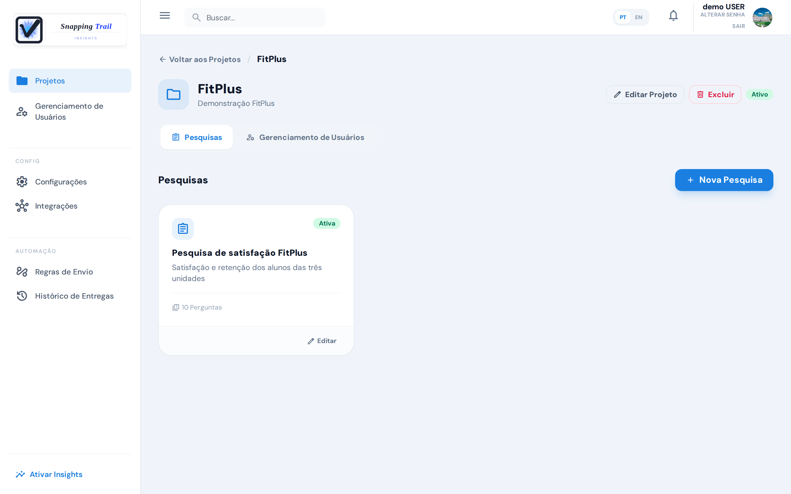
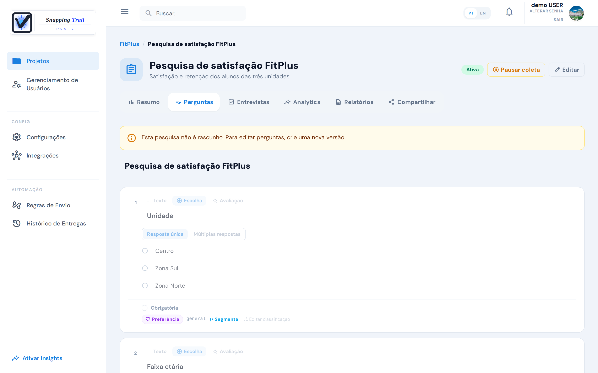
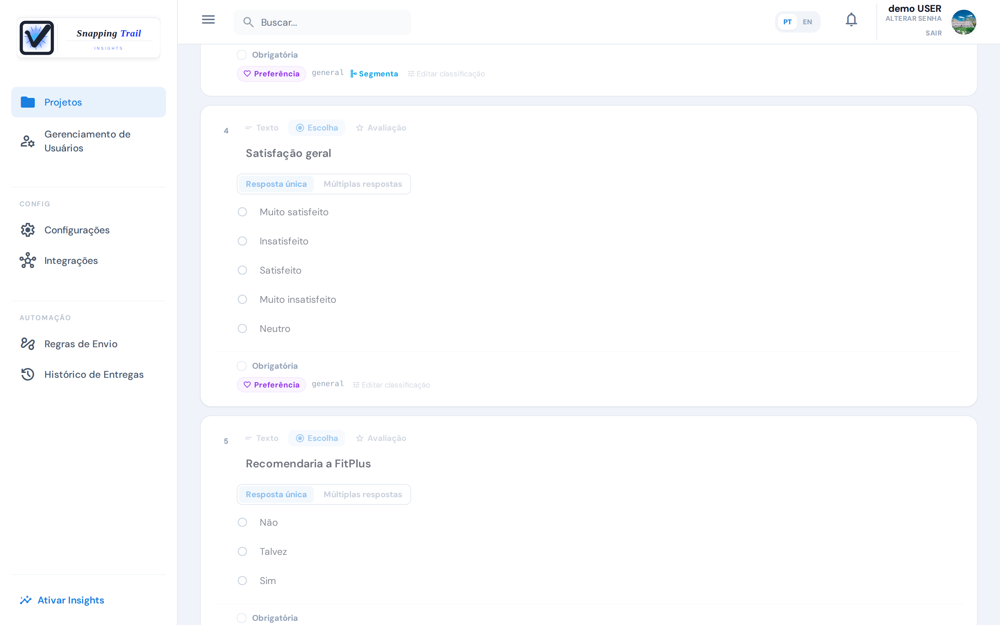

Uma pesquisa é o questionário que os seus respondentes preenchem. As pesquisas ficam dentro de um **projeto**, e um projeto pode reunir várias pesquisas sobre o mesmo assunto.

Só **administradores** criam e editam pesquisas. Os entrevistadores veem as pesquisas ativas dos seus projetos em **Minhas Pesquisas**.

## Crie uma pesquisa

1. Abra **Projetos** e escolha um projeto.
2. Escolha **Nova Pesquisa**. Dê um **Título da Pesquisa** e, se quiser, uma **Descrição**, e escolha **Criar Pesquisa**.
3. Acrescente perguntas com **Texto**, **Escolha** ou **Avaliação**.

Uma pesquisa nova começa como rascunho. **Salvar** guarda o seu trabalho; **Publicar** deixa a pesquisa ativa.

## Tipos de pergunta

| Tipo | O que mede |
|---|---|
| **Texto** | Uma resposta livre, nas palavras do respondente: uma opinião, um motivo, um comentário. |
| **Escolha**, com **Resposta única** | Uma opção de uma lista, como a unidade ou o plano. |
| **Escolha**, com **Múltiplas respostas** | Todas as opções que se aplicam, como os serviços que a pessoa usa. |
| **Sim/Não** | Um sim ou um não. O atalho preenche as opções **Sim** e **Não**. |
| **Likert** | A concordância com uma afirmação. O atalho preenche cinco opções, de "Discordo totalmente" a "Concordo totalmente". |
| **Avaliação** | Uma nota numa escala, em **Escala de resposta**. |

Numa pergunta de **Avaliação**, escolha um dos modelos ou defina a sua escala:

| Modelo | Escala | O que mede |
|---|---|---|
| **NPS** | 0 a 10 | O quanto a pessoa recomendaria você |
| **CSAT** | 1 a 5 | O quanto a pessoa está satisfeita |
| **CES** | 1 a 7 | O quanto foi fácil fazer algo |
| **Personalizada** | O seu **Mínimo**, **Máximo** e **Incremento** | Qualquer outra nota |

Marque **Obrigatória** quando toda entrevista concluída precisar responder a pergunta. A resposta é conferida quando a entrevista é concluída, e só para as perguntas que o respondente viu.

## Perguntas condicionais

Em qualquer pergunta de escolha (Resposta única, Múltiplas respostas, Sim/Não ou Likert), cada opção pode abrir uma **pergunta condicional**, mostrada só para quem escolheu aquela opção. Por exemplo, "Principal motivo de insatisfação" pode aparecer só para quem respondeu "Insatisfeito"; os demais nunca a veem.

Ao lado da opção, escolha **Condicional** e escreva a pergunta. A condicional é respondida com texto livre. Marque **Obrigatória quando exibida** se quem a vê precisa respondê-la.

## Status

| Status | O que significa |
|---|---|
| Rascunho | Em construção. Ninguém consegue responder ainda. |
| Ativa | Aberta para respostas. Uma pesquisa precisa de pelo menos uma pergunta para ficar ativa. |
| Inativa | Fechada para novas entrevistas. As entrevistas já iniciadas ainda podem ser concluídas, e as respostas são preservadas. |

**Pausar coleta** deixa uma pesquisa ativa inativa, e **Retomar coleta** a abre de novo.

## Pesquisas ativas e o seu plano

Cada plano permite um número de pesquisas ativas ao mesmo tempo: 2 no **Free**, 30 no **Starter** e sem limite no **Pro** (e durante o período de teste). Quando a sua empresa já tem esse número, publicar um rascunho ou retomar uma pesquisa pausada é recusado, e o app diz, por exemplo:

> O plano Free permite até 2 pesquisas ativas ao mesmo tempo. Pause outra pesquisa, ou mude para o plano Starter, para ativar esta.

As pesquisas que já estão ativas continuam ativas, mesmo depois da mudança para um plano menor: só a próxima ativação é recusada.

## Altere uma pesquisa que não é mais rascunho

Quando a pesquisa deixa de ser rascunho, as perguntas não podem mais mudar: o construtor as mostra só para leitura. O título e a descrição continuam editáveis.

Para mudar as perguntas, escolha **Nova versão**. Ela cria um novo rascunho com uma cópia das perguntas, que você edita e depois publica. A pesquisa anterior mantém as respostas dela.

## Exclua uma pesquisa

Só um rascunho sem respostas pode ser excluído, e a exclusão é definitiva. Uma pesquisa que já esteve ativa não é excluída: pause a coleta dela.

## Próximos passos

- [Colete respostas por link ou QR Code](../collection)
- [Colete em campo com o app Collect](../collect-app)
